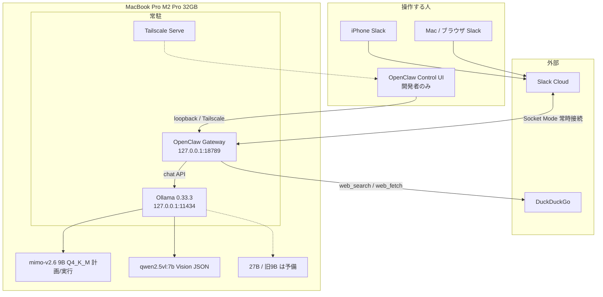
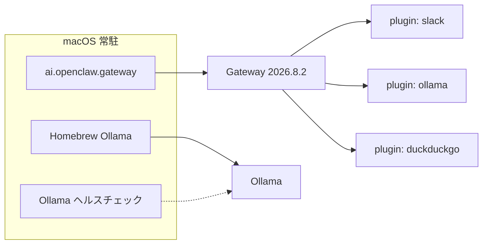
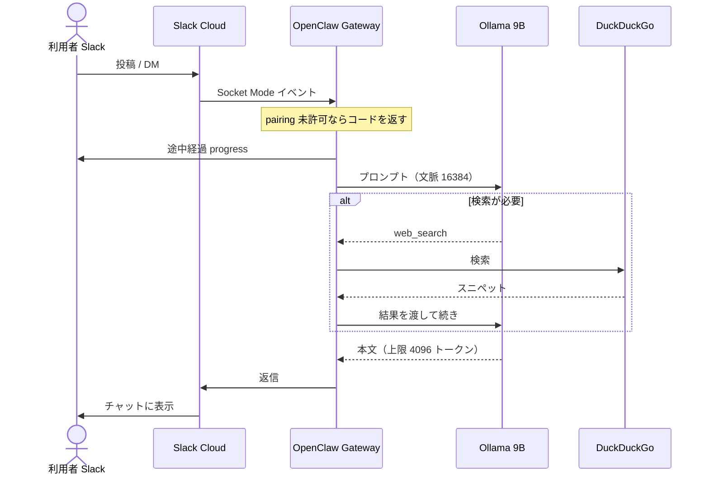
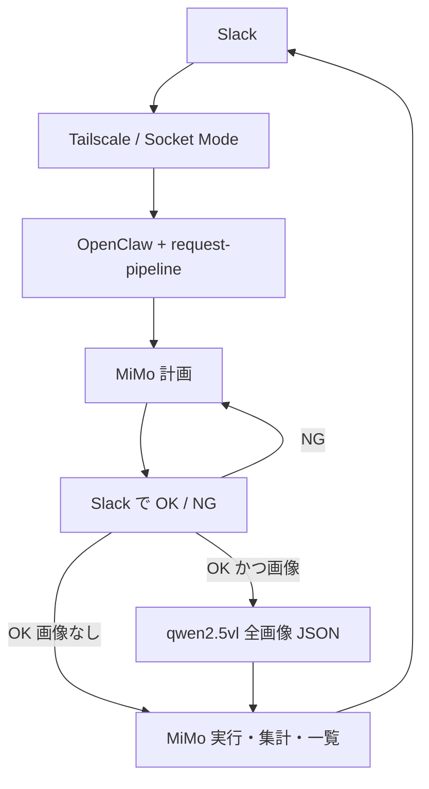
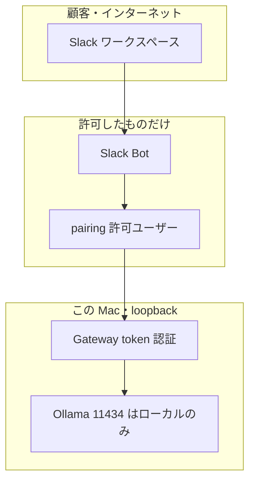

# OpenClaw AI エージェント構成（MacBook Pro M2）

作成日: 2026-09-16  
更新: 2026-09-25（計画承認パイプライン）  
対象機: **開発機**（顧客には貸さない）

このファイルは、いま動いている構成のスナップショットです。Mac mini 試験機は未導入です。

---

## 1. 役割

| 役割 | いま | 予定 |
| --- | --- | --- |
| 開発・実験 | **この MacBook Pro** | 継続 |
| 顧客向け実行環境 | （未導入） | Mac mini に OpenClaw を載せ、顧客はマシンを触らない |
| 顧客の操作面 | Slack（検証中） | Slack のまま |

顧客は SSH・画面・OpenClaw Control UI を使わない。入り口は Slack のみ。

---

## 2. ハードウェア

| 項目 | 値 |
| --- | --- |
| 機種 | MacBook Pro 14インチ（`Mac14,9`） |
| SoC | Apple **M2 Pro** |
| CPU | 10コア（性能 6 + 効率 4） |
| GPU | 16コア |
| メモリ | 統一メモリ **32GB** |
| メモリ帯域 | 約 200 GB/s |

ローカル LLM はメモリ帯域が生成速度を決める。32GB なら常時モデルは **Qwen 3.5 9B** が妥当。27B は動くが待ちが長く、試験機向きではない。

---

## 3. 全体図



要点:

- Slack は Mac へinbound HTTPS を開けない。**Socket Mode**（Mac から Slack へ外向き WebSocket）で受ける。
- Gateway の bind は **loopback**。公開ポートは出さない。
- 推論は全部この Mac 上。クラウド LLM は使っていない。

---

## 4. ソフトウェア構成



| 層 | 実体 | メモ |
| --- | --- | --- |
| エージェントランタイム | OpenClaw **2026.8.2** | LaunchAgent `ai.openclaw.gateway` |
| 推論サーバ | Ollama **0.33.3** | Homebrew サービス + 60秒ヘルスチェック |
| 主モデル | `ollama/maternion/mimo-v2.6:9b-thinking-q4_K_M` | GPU常駐、thinking on、計画と実行 |
| Vision | `qwen2.5vl:7b` | GPU常駐。承認後に全画像を JSON 化。チャット既定にはしない |
| 予備 | `qwen3.5:9b` / mimo Q6_K / 27B Q3 | `/model` で切替可 |
| 顧客チャネル | Slack Socket Mode | pairing で送信者を許可 |
| 開発者 UI | Control UI `:18789` | Tailscale Serve あり。顧客には出さない |
| 検索 | DuckDuckGo | 地域 `jp-jp` |

---

## 5. メッセージの流れ（Slack）



体感が Control UI / iPhone OpenClaw アプリより速い理由はモデル差ではない。Slack は生成中に経過を出し、120秒の `agent.wait` で切らない。

---

## 5.1 リクエストパイプライン（2026-09-25）



実装場所:

- コード: `~/Documents/AkiLocalAiAgent/openclaw-request-pipeline/`
- 案件: `~/.openclaw/workspace/requests/YYYYMMDDHHMMSS/`
  - `YYYYMMDDHHMMSS.md` 本文・プラン・承認
  - `YYYYMMDDHHMMSS_0001.log` 実行ログ（20MB で 0002…）
  - `input/` `vision/vision.json` `output/`
- 類似案件があれば「続きか、拡張実施か？」と聞いてからフォルダを再利用 or 新規作成

起きてからの確認:

1. Slack に「テスト: 来週の予定を一覧にして」→ プランだけ返るか
2. `OK` → 実行されるか / `NG 日付順で` → 再計画するか
3. 画像付きで整理依頼 → 承認後に `vision/vision.json` ができるか
4. `ollama ps` で mimo Q4 と qwen2.5vl が載っているか

---

## 6. モデルとコンテキスト

| 項目 | mimo Q4（既定） | qwen2.5vl:7b | 旧 qwen3.5:9b |
| --- | --- | --- | --- |
| ディスク目安 | 約 6.5GB | 約 6.0GB | 約 6.6GB |
| 文脈 `num_ctx` | 16384 | 8192 | 16384 |
| 出力上限 | 4096 | 2048 | 4096 |
| 役割 | 計画・承認後の実行 | 画像→JSON のみ | 予備 |
| keep_alive | 常駐 | 常駐 | 15分 |

実験メモ:

- 27B 3bit の長作業は約 5分、9B は約 1分12秒（同一系統の依頼）。
- 文脈を 32k にすると、短い「ハロー」でも先読みで iPhone 待ち（120秒）に負ける。
- ツールを全部出すと 9B がカタログ巡回して遅くなる。いまは **minimal + `web_search` / `web_fetch` のみ**。

---

## 7. セキュリティ境界



- Slack DM は **pairing**。未許可ユーザーはコードだけ返り、所有者が `openclaw pairing approve slack <code>` する。
- コマンド所有者は Slack ユーザー ID で制限。
- Gateway は token 認証。Control UI と Tailscale は開発者用。
- 顧客に渡す予定の試験機でも、同じ「Slack だけ・本体は触らせない」にする。

このファイルにはトークンを書かない。実トークンは `~/.openclaw/openclaw.json` 側。チャットに出したキーは試験後に再発行すること。

---

## 8. 運用（開発者）

途中キャンセル（Slack DM）:

```text
/stop
```

`stop` だけでも通ることがある。連続送信は輻輳する。GPU を奪い合うか、5分で Slack がタイムアウトする。

観察:

```bash
ollama ps
ps -axo pid,pcpu,pmem,etime,command | awk 'NR==1 || /llama-server|openclaw/'
openclaw sessions --active 30
openclaw sessions tail --follow
openclaw logs --follow --local-time
openclaw channels status --probe
```

`sessions tail` の時刻は UTC。古い `error` 行が再表示されても、本体死亡とは限らない。`status: done` かつ `llama-server` の CPU がほぼ 0 なら待ち続けない。

---

## 9. 既知の制約（9B + この構成）

1. 「やります」と言ってターンを閉じ、ツールを呼ばないことがある。
2. 実在企業の表は検索しても推定・取り違えが混ざる。客向け確定情報にはしない。
3. 長い表は出力上限で切れる（いま 4096）。切れても `continue` と次の依頼を重ねない。
4. `.md` 添付は小さいファイルでも往復が重い。短い成果は Slack 本文で足りる。
5. Control UI は Tailscale 経由だと 120秒待ちで「止まった」ように見える。客 IF には使わない。

---

## 10. 次の箱（未購入）

この MBP は開発機のまま。顧客試験機は **Mac mini を常時起動**し、同じ OpenClaw + 9B + Slack を載せる想定。

予算の上限感（日本 Apple、税込・2026年8月発表時点）:

| 構成 | おおよそ | 位置づけ |
| --- | --- | --- |
| M6 mini 32GB / 512GB | 約 25.4 万円 | 試験機として現実的 |
| M5 Pro mini 48GB / 512GB | 約 39.7 万円 | 32GB 枠がなく、一段高い |

M6 mini 32GB の帯域は約 170GB/s で、この M2 Pro（200GB/s）より生成は速くならない。効くのは先読みと、ノートのようにスリープしないこと。

---

## 11. コンポーネント対応表

| 人が触るもの | プロセス | 待ち受け |
| --- | --- | --- |
| Slack アプリ | なし（クラウド） | Slack → Socket Mode → Gateway |
| Control UI | Gateway | `127.0.0.1:18789` と Tailscale Serve |
| 推論 | `ollama` / `llama-server` | `127.0.0.1:11434` |
| 設定 | `~/.openclaw/openclaw.json` | — |
| ワークスペース | `~/.openclaw/workspace/` | AGENTS.md など |
| ログ | Gateway ファイルログ | `~/Library/Logs/openclaw/` と `/tmp/openclaw/` |
